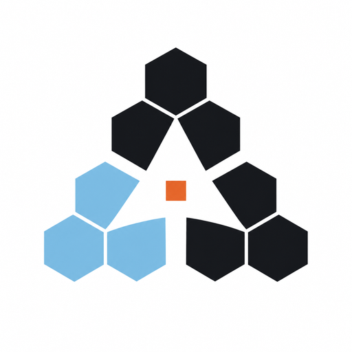
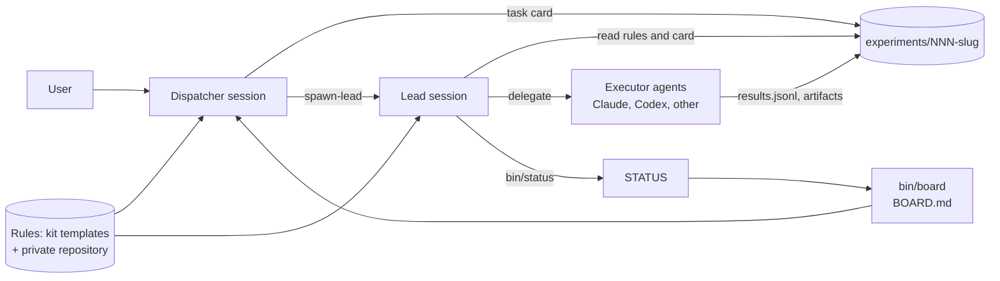

<p align="center">
  
</p>

<h1 align="center">AgentHelm</h1>

<p align="center">
A local-first workspace that lets one dispatcher session hand research tasks to multiple Lead and executor agents (Claude Code, Codex) under one rule set and one task board.
</p>

<p align="center">
  <a href="LICENSE"></a>
</p>

维护者：欧聪杰（[Jack-OuCJ](https://github.com/Jack-OuCJ)）

项目仓库：[Jack-OuCJ/AgentHelm](https://github.com/Jack-OuCJ/AgentHelm)

## What it is

AgentHelm keeps research state on disk, so several agent sessions share one rule set and one task board.

Without it, each session reads different rules, status lives in chat, and after `/clear`, context compaction or a machine change the next session starts from nothing.

Use it when several Claude Code or Codex sessions work in parallel on experiments, reproductions or option comparisons. A single-session, one-off question does not need it.

What the shipped rules and tools give you:

- **A research workflow that sizes before it runs**: a pilot measures cost per sample, the sample size is derived from the gap you need to resolve, fairness is checked before scaling, and conclusions use a fixed Tendency/Confidence format with numbers traceable to `results.jsonl`.
- **One alignment round per task**, with a fixed confirmation layout, four allowed reasons to interrupt the user afterwards, and a skip when the task card says the user pre-authorized defaults.
- **Named roles instead of model names**: ten roles in three tiers; a local `roles.toml` maps roles to your models and commands, and `bin/models` renders the table every agent reads.
- **A bounded review loop**: one parallel round by different models, one merged fix list, one re-review of the fix diff.
- **Context that survives `/clear`**: STATUS, task memory and conclusion lines are injected at session start.
- **Checks**: `bin/kb lint` for missing fields, broken paths in rules, size budgets and cleanup; `bin/scrub-check` before anything leaves the machine.

## Architecture

The diagram shows one task's path from the dispatcher to a recorded result. The table lists what each role reads and writes, and who starts it.



| Role | Reads | Writes | Started by |
| --- | --- | --- | --- |
| Dispatcher | `BOARD.md`, `STATUS` file | task directories, start prompts | you |
| Lead | root `AGENTS.md`, the task card, `INDEX.md` | `STATUS`, the conclusion | `bin/spawn-lead`, or you in `cli-plain` and `app` |
| Executor | the delegation prompt and the root `AGENTS.md` | assigned files, `results.jsonl`, artifacts | the Lead |

## Rules layering

Generated rules come from four sources:

1. `templates/` in the kit: public defaults for the workflow, executor conventions and runtime environments.
2. Your private rules repository: its `rules/` and `templates/` replace files with the same name in the installed workspace.
3. `~/.claude/local.md`: machine facts (hardware, timezone, concurrency measure, storage, browser tool, notification channel); it stays on the machine.
4. `~/.config/research/models.md`: the role-to-model table that `bin/models` generates from `~/.config/research/roles.toml`; it stays on the machine.

`bin/kb sync-agents` writes `~/.claude/AGENTS.md`; when `~/.codex`, `~/.gemini` or `~/.pi/agent` exist, it writes the same content there.

Each file contains the executor conventions, the environment section, `local.md`, `models.md` and `rules/claude-global.md`. The workspace gets `AGENTS.md` (from `templates/research-AGENTS.md`) and `rules-extra.md` (from `templates/research-extra.md`: strict mode, long runs, context handover, cleanup and conflicts). `~/.claude/CLAUDE.md` gets one `@AGENTS.md` line; replaced files are saved as `*.before-agenthelm`.

Private rules are optional. Without a repository, the shipped templates are used and `rules-pull` and `rules-push` exit 0.

With one, edit `rules/` or `templates/` in `~/.local/share/research-rules`; the repository needs at least one commit before selection.

After editing, run `bin/install-rules` to apply locally; `bin/rules-push` publishes, and `bin/rules-pull` pulls and reapplies.

- `rules-push` first runs `bin/install-rules`, then `bin/kb lint` (errors outside `experiments/` block the push), then `bin/scrub-check`; it rebases with autostash, and on failure aborts the rebase, keeps your local commit and exits 1.
- `rules-pull` only warns on failure and skips while a rebase is in progress, so it never blocks a session.
- The weekly cron job is not installed when `HOME` is in a temporary directory (`/tmp` or the macOS temporary folder), as in test runs.

### Optional: keep the whole workspace in Git

The default syncs only `rules/` and `templates/`. If you prefer to version the entire workspace (tasks, cards, reports), keep the Git data outside it so agents scanning the directory do not see it, for example `git --git-dir="$HOME/.local/share/research.git" --work-tree="$HOME/research"`, wrapped in a small alias. Ignore large artifacts, virtual environments and credentials, and run `bin/scrub-check --git-dir <path>` before every push so the external history is scanned too. This mode is a documented option, not something the kit sets up.

## Runtime environments

Three environments are available: `cli-herdr` (recommended for terminals), `cli-plain` (terminal without herdr) and `app` (Claude app or Codex app). `bin/spawn-lead` reads the choice from `~/.config/research/env`.

| Aspect | `cli-herdr` | `cli-plain` | `app` |
| --- | --- | --- | --- |
| Lead startup | `bin/spawn-lead` creates a herdr tab and starts Claude or Codex there | prints the start prompt; open another terminal or tmux and paste it | prints the prompt; create a session or project in the app at the task directory |
| Dispatcher-Lead communication | same harness: built-in cross-session messaging; mixed Claude/Codex: `herdr agent prompt` | through `STATUS` and `bin/board` only | through `STATUS` and `bin/board` only |
| Concurrency | count with `herdr agent list` | limited by machine resources | managed by the app |
| Cleanup | close the tab and confirm no process remains | close the terminal | handled by the app |

Choose `cli-herdr` or `cli-plain` for a terminal, and `app` for the Claude app or Codex app. `app` does not install herdr. The choice is per machine and does not enter any repository.

## Install

Requires Linux or macOS, Python 3.9+, Git, a POSIX shell and `jq`. No administrator access is needed. Get a local copy of this repository, open an agent session in it, and send this prompt:

```text
Read skills/research-setup/SKILL.md in this checkout and set up my research workspace.
Ask all setup questions first and install only the components I select.
```

The skill collects the installation directory (default `~/research`), environment, role, board, optional components and a private rules repository, then runs the installer and checks.

See `skills/research-setup/SKILL.md` for details. To upgrade, run the skill from an updated kit copy.

`deploy` refreshes `bin/`, `templates/`, the skill and `assets/logo.png`, and keeps other workspace files.

### Optional components

| Component | What it adds | Installed as |
| --- | --- | --- |
| herdr | Terminal tabs and sessions | Linux or macOS binary in `~/.local/bin` |
| ponytail | Code-minimization guideline skill | Claude plugin, Codex skill, or both |
| caveman | Output-style skill | Claude plugin, Codex skill, or both |
| claude-hud | Claude Code status bar | Claude plugin; activate it inside Claude Code |
| skills-library | Scientific skills catalog | copied into `<workspace>/skills-library`; dependencies are not installed |

Sources: [herdr](https://github.com/herdrdev/herdr), [ponytail](https://github.com/DietrichGebert/ponytail), [caveman](https://github.com/JuliusBrussee/caveman), [claude-hud](https://github.com/jarrodwatts/claude-hud) and the MIT [scientific skills library](https://github.com/K-Dense-AI/scientific-agent-skills). The kit downloads each component from its upstream repository at install time and does not bundle upstream code.

- Add a component later with `bin/install-component <name>`; ponytail and caveman also accept `--agent claude|codex|both`.
- herdr installs to `~/.local/bin`; keep that directory on `PATH` so `bin/spawn-lead` can find it.

## Layered delegation (Orchestra)

Layered delegation, called Orchestra in the templates, sends each piece of work to the cheapest role that can do it. Rules name roles only; which model plays each role is a local choice.

| Role | Tier | Does |
| --- | --- | --- |
| `lead` | Strategist | aligns, designs, accepts and concludes one task |
| `lead_important` | Strategist | the same for tasks the user marks important |
| `visual` | Strategist | visual design and construction |
| `writing` | Strategist | report prose and documentation |
| `hard` | Executor | hard debugging, critical implementation, reproductions |
| `fact` | Executor | default execution: exploration, implementation to a spec, experiments, tests |
| `review` | Executor | code review, two different models in parallel |
| `simplify` | Executor | simplification pass over a finished change |
| `aesthetic` | Executor | aesthetic review of visual work |
| `chore` | Helper | fixed, mechanically checkable work: search, log extraction, template filling, cleanup |

The full does/does-not table, delegation rules and the review loop are in `templates/claude-global.md`.

Configure roles:

```bash
cp templates/roles.toml.example ~/.config/research/roles.toml
$EDITOR ~/.config/research/roles.toml    # providers, command templates, candidates per role
bin/models                               # render models.md and run bin/kb sync-agents
bin/models get fact                      # print the selected provider, model and effort; full commands are in ~/.config/research/models.md
bin/models check                         # run each provider's optional check command
```

To change a role or switch a provider off (for example when its quota runs out), edit `roles.toml` (`candidates`, or `[providers]`) and rerun `bin/models`; roles fall back to their next enabled candidate.

- Each role lists `candidates` as `provider:model[:effort]`; `mode = "first"` takes the first enabled one, `mode = "all"` uses every enabled one (for parallel reviewers).
- `research = true` adds the provider's `research_flags` to the command (for example, disabling a code-minimization plugin for research work); `"split"` renders both a research command and a construction command.
- With only one model family, map Strategist roles to its strongest model and `chore` to its smallest.
- `bin/spawn-lead` takes the Lead model from `bin/models get lead` (or `lead_important`). Without `roles.toml` it still reads the legacy `~/.config/research/roles` (`kind`, `model`, `effort`). If `roles.toml` has no Lead role, it falls back to the legacy file, then to plain `claude`. When `--kind` names a different harness than the role's provider, no model is passed and that harness uses its default. Models are applied only when a herdr tab is started; in `cli-plain` and `app` the printed prompt is followed by a `Lead selection` line so you can start the session with the same model.

## Tasks

Write a task card from `templates/task-card.md` and open the task:

```bash
cd ~/research
$EDITOR /tmp/card.md                      # question verbatim, type, pre-authorized, decisions, budget
bin/new-task baseline-eval < /tmp/card.md  # creates experiments/NNN-baseline-eval/ and starts a Lead
bin/new-task paper-repro --important < /tmp/card.md
```

- `bin/new-task` numbers the directory (counting `archive/` too), writes the card to `README.md` (or copies the template when stdin is a terminal), creates `findings/`, sets STATUS to `running` and calls `bin/spawn-lead`. In `cli-herdr` at most `RESEARCH_MAX_LEADS` Leads (default 4) run at once; `--kind codex` starts a Codex Lead.
- `bin/spawn-lead <task-dir>` starts a Lead for an existing task directory. In `cli-plain` and `app` it prints the start prompt to paste.
- With `Pre-authorized: yes` in the card, the Lead skips the confirmation round and writes the frozen version directly.
- Update status from the task directory with `~/research/bin/status running "Baseline run" 0.20`. `bin/status` accepts `running`, `needs-input`, `blocked` and `done`; every change reruns `bin/board`, `bin/kb index` and the Notion mirror when configured.
- Record each real run in `results.jsonl` with `command`, `exit_code` and `artifact`; `bin/kb lint` rejects incomplete records.
- Write conclusions as `## Conclusion (YYYY-MM-DD)` followed by `- **Tendency**: …` and `- **Confidence**: …`; the index parses these lines.
- Delegated exploration writes `findings/<topic>-<executor>.md`; long-lived task notes go to `memory/` with a `memory/MEMORY.md` index.
- Research cards live in `cards/<id>.md` with `id`, `topic`, `sources`, `date`, `valid_for` and `superseded_by`, within 150 lines.

### Context after `/clear`

The Claude Code SessionStart hook (installed by the setup skill) runs `bin/lead-watch-start`. Codex has no such hook: Codex-only users run `~/research/bin/lead-reload .` (or `<workspace>/bin/lead-reload .`) from the task directory at the start of each new session.

- At a task root it calls `bin/lead-reload`, which injects STATUS, this task's conclusion lines from `INDEX.md` and `memory/MEMORY.md`; after 3 compactions it reminds the Lead that the session can be cleared after the next milestone.
- At the workspace root (dispatcher) it injects `TODO.md`, the STATUS of unfinished tasks and the last 3 finished ones.

### Commands

| Command | Does |
| --- | --- |
| `bin/new-task <slug> [--important] [--kind claude\|codex]` | create a numbered task from a card on stdin and start its Lead |
| `bin/spawn-lead <task-dir>` | start or print the start prompt for a Lead |
| `bin/status <state> [desc] [cost]` | write STATUS, refresh board, index and Notion |
| `bin/board` | print the board and write `BOARD.md` |
| `bin/models [get <role>\|check]` | render `models.md` and sync agent rules; print one role; probe providers |
| `bin/lead-reload <task-dir>` | print the handover context for a task |
| `bin/kb index \| lint [--brief] \| sync-agents` | regenerate indexes, check the workspace, regenerate agent rules |
| `bin/install-rules`, `bin/rules-pull`, `bin/rules-push` | apply, pull and publish private rules |
| `bin/scrub-check` | scan for secrets and private terms before sharing |
| `bin/install-component <name>` | install an optional component |
| `bin/build-routers` | generate skill routers from your local `~/.config/research/routers.toml`; without it, prints the schema |

`bin/kb lint` reports errors for missing card or result fields and for `bin/…` or `templates/…` paths in rule files that do not exist, and warnings for size budgets (workspace `AGENTS.md` 16384 bytes, `rules/claude-global.md` 8192 bytes, `INDEX.md` 300 lines, cards 150 lines, task READMEs 300 lines) and for finished task directories over 200 MB. The budgets are constants at the top of `bin/kb`.

### Board

Notion is the recommended board. The local board is always written and needs no external service: `bin/board` prints the table, writes `BOARD.md` and includes `TODO.md`.

- Create `~/.config/research/notion.env` with `NOTION_DB` and `NOTION_TOKEN`, and share the database with the integration.
- Use properties `Name` (title), `Status`, `Summary`, `Cost` and `Conclusion` (rich text). Task IDs must be unique across machines that share the database.
- Optional `Machine` property (select or rich text) for several machines sharing one database: written only when `~/.config/research/machine` exists; an existing row with an empty Machine is filled in rather than duplicated.
- A network failure keeps the local `STATUS` and leaves `.notion-pending`; rerun `bin/notion-sync <task-dir>`.

## Customize for your environment

The kit ships rules that name roles and say "see local.md"; everything machine- or account-specific is yours to fill in. Recommended choices:

| Item | Where | Recommendation |
| --- | --- | --- |
| Models, commands, providers | `~/.config/research/roles.toml` (from `templates/roles.toml.example`) | Strongest model for `lead_important`, `visual` and `writing`; a capable mid-price model for `lead`, `fact` and `hard`; the cheapest for `chore`; two different families for `review`. Put every CLI invocation, including flags, in the command templates. |
| Proxies, gateways, quota | `roles.toml` command templates and your shell environment | Keep endpoints and keys in environment variables or `~/.config/research/`, never in rules. When a quota runs out, set that provider to `false` under `[providers]` and rerun `bin/models`. |
| Machine size and concurrency | `local.md`, "Machine" and "Concurrency" | Measure with `skills/research-setup/scripts/hardware`. Gate parallel tests, builds and browsers by your user's real anonymous memory, not "available" memory; set build parallelism to about half the CPUs. |
| Timezone | `local.md`, "Time" | The zone you want times reported in, plus the command that prints it. |
| Notifications | `local.md`, "Notifications" and the environment section | Built-in cross-session messaging where the harness has it; otherwise STATUS plus `bin/board`. Phone push is optional private wiring. |
| Notion | `~/.config/research/notion.env` | Optional; without it the local `BOARD.md` is the board. |
| herdr | `~/.config/research/env` | `cli-herdr` for terminals if you want automatic Lead tabs; `cli-plain` or `app` otherwise. |
| Browser checks | `local.md`, "Browser checks" | One tool per platform, one browser at a time, closed after use; on headless Linux a CLI automation tool driving local Chrome, on macOS a desktop browser agent. |
| Skill library path and routers | `<workspace>/skills-library` (optional component) | Install only the skills you use. For domain routers, write `~/.config/research/routers.toml` (library path, output directory, prefix, one entry per router) and run `bin/build-routers`; every library skill must belong to exactly one router. |
| Private rules | your own Git repository | Override only `rules/` and `templates/`; keep personal preferences there, not in the kit. |

## Privacy

The repository contains no credentials or personal rules. Keep private scrub terms in `~/.config/research/scrub-terms.txt`, one expression per line.

- `bin/scrub-check` scans working files (including ignored files), filenames, symlink targets and committed Git history.
- It prints locations and redacts matched content; it reads working files and committed history, not the Git index, so commit before scanning.
- Without the private list it warns and checks generic secret patterns only.
- Run it before sharing the workspace or sending a patch.

Notion credentials belong in `~/.config/research/notion.env`, never in chat or a repository.

Global rule files replaced by the installer are saved as `*.before-agenthelm`; inspect them before deleting.

## Repository layout

```text
<workspace>/                    # default ~/research
├── README.md, LICENSE          # copied when absent
├── AGENTS.md                   # workflow rules (from templates/research-AGENTS.md)
├── rules-extra.md              # strict mode, long runs, handover, conflicts
├── INDEX.md, EXPERIMENTS.md    # generated by bin/kb index
├── BOARD.md                    # generated by bin/board
├── TODO.md                     # dispatcher's open items (optional)
├── bin/                        # new-task, spawn-lead, status, board, models, lead-reload, kb, rules-*, scrub-check
├── templates/                  # task card, rule templates, environment sections
├── skills/research-setup/      # installer skill, linked into ~/.claude and ~/.codex
├── rules/claude-global.md      # generated from templates or a private override
├── experiments/<task-id>/      # README.md (task card + conclusion), STATUS, results.jsonl, findings/, memory/
├── cards/, reports/            # research cards and reports
└── skills-library/             # optional component
```

Outside the workspace: `~/.claude/local.md` (machine facts), `~/.config/research/` (`env`, `role`, `roles.toml`, `models.md`, `notion.env`, `scrub-terms.txt`).

`deploy` copies `bin/`, `templates/`, the skill and `assets/logo.png`, and adds `README.md` and `LICENSE` when absent; `install-rules` creates `experiments/`, `cards/`, `reports/` and `rules/`.

## Limitations

- Private rules repositories currently overlay only `templates/` and `rules/`; they do not overlay `bin/`, and no private-script override point exists yet.
- The `app` environment has not been verified in a real Claude App or Codex App session.
- `bin/models check` only runs the check commands you configure; it does not verify that a model name exists or that quota remains.
- The sample-size formulas are rules of thumb for paired or unpaired accuracy comparisons, not a replacement for a power analysis.
- `bin/build-routers` ships without a category table; you write `~/.config/research/routers.toml` yourself.
- Rule templates are English only.

## License

MIT. Separately downloaded components retain their upstream licenses.

## 中文简介

AgentHelm 是一个本地优先的研究工作区：一个调度台会话把任务派给多个 Lead 和执行 agent（Claude Code、Codex），共用一套规则和一个任务看板。

- 规则分四层：kit 模板、私有规则仓库、`~/.claude/local.md` 中的本机事实、`bin/models` 生成的 `~/.config/research/models.md`。生成的 `AGENTS.md` 分发给各 agent。
- 任务放在 `experiments/<task-id>/`，含任务卡、`STATUS`、`results.jsonl` 和产物。看板推荐 Notion，本地 `bin/board` 无需外部服务。
- 运行环境三选一：`cli-herdr`（终端，推荐）、`cli-plain`（终端，不用 herdr）、`app`（Claude app / Codex app）。安装时询问，写入 `~/.config/research/env`。
- 在仓库副本中打开 agent 会话，把安装提示交给它。
- 分层委派：规则只写角色名（lead、lead_important、visual、writing、hard、fact、review、simplify、aesthetic、chore，分属 Strategist、Executor、Helper 三层）；本机 `~/.config/research/roles.toml` 决定每个角色用哪个模型和命令，`bin/models` 生成 `models.md` 并并入各 agent 的规则。
- 研究流程：先试点再按要分辨的差距算样本量，先验证公平性再放大；对齐一轮（任务卡写明预授权时免对齐）；结论用固定的 Tendency/Confidence 格式；审查一轮并行、一张修复单、只复审修复 diff。
- `bin/new-task` 一键开任务；`/clear` 后由 `bin/lead-reload` 注入 STATUS、任务 memory 与结论行。
- 机器规格、时区、并发口径、浏览器、通知、Notion、herdr 都在 `local.md` 或 `~/.config/research/` 里按你的环境自定义，见「Customize for your environment」。`app` 环境尚未实测。
- `bin/scrub-check` 在分享前扫描工作文件、文件名和 Git 历史。许可证 MIT；第三方组件遵循各自许可。

## 来源

基于 [blankhoney/agentlord](https://github.com/blankhoney/agentlord) 的 `main` 分支快照 `8c96addde0a35230bed7ff9db45affd1c31bf051` 创建。AgentHelm 使用独立的 Git 提交历史。

AgentHelm 由欧聪杰（Jack-OuCJ）维护，采用 [MIT License](LICENSE)。所包含的上游代码的原始版权与完整许可见 [NOTICE](NOTICE)。
